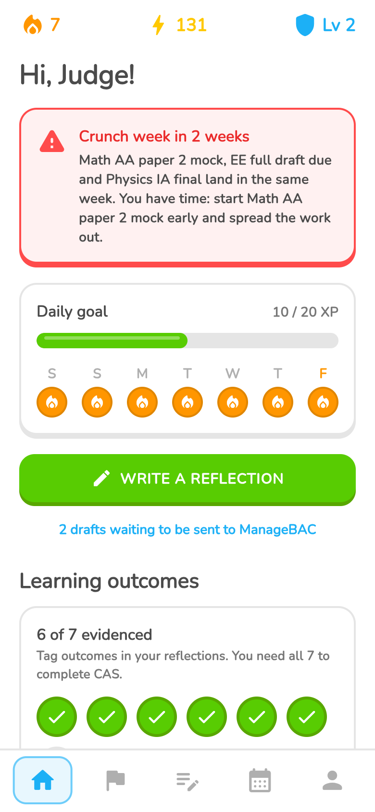
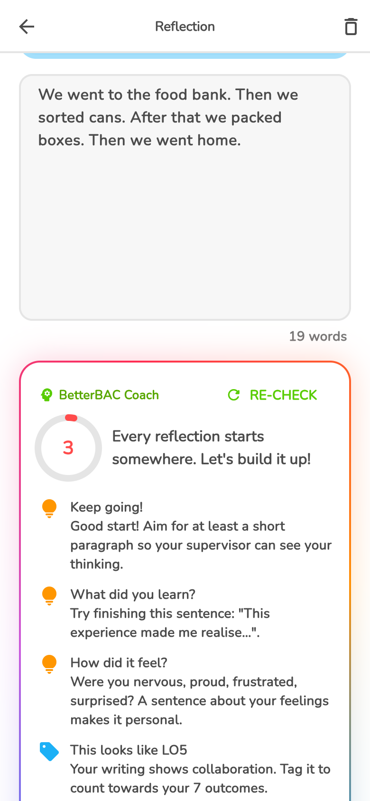
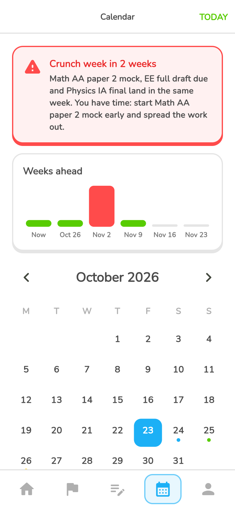
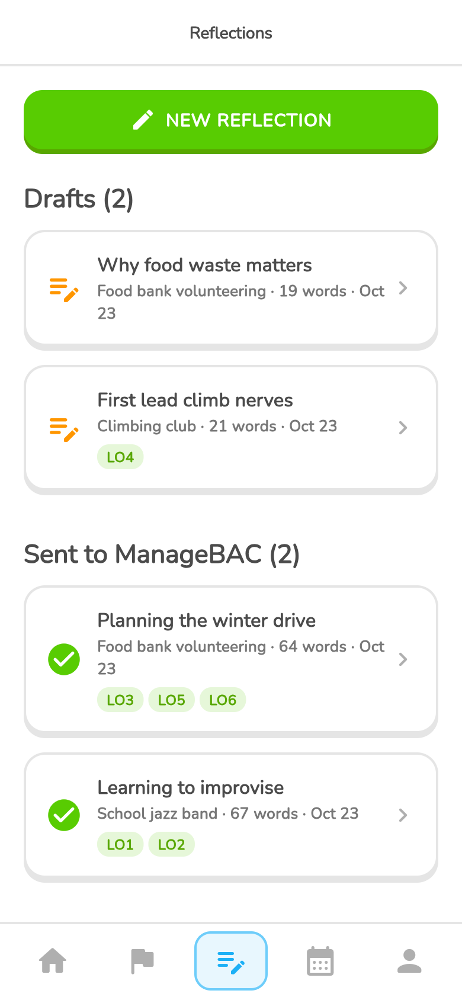

# BetterBAC

**ManageBAC tracks requirements. BetterBAC builds habits.**

BetterBAC is a free, private companion app for IB Diploma students. It puts CAS,
reflections and every IB deadline in one friendly place, turns the work into
streaks and progress the way Duolingo does for languages, and warns students
before their workload becomes overwhelming.

Built with Flutter and Rust for iOS, Android, macOS, Windows and the web.

**▶ Try the demo in your browser: https://link-coder100788.github.io/BetterBAC/**
<sub>No sign-up. Your data stays in your own browser. Tip: Profile → Developer
menu → *Seed sample data* fills the app with a realistic example student.</sub>

<table>
  <tr>
    <td align="center"><br><sub><b>Home</b>: streak, XP, daily goal</sub></td>
    <td align="center"><br><sub><b>Reflection coach</b></sub></td>
    <td align="center"><br><sub><b>Crunch-week warnings</b></sub></td>
    <td align="center"><br><sub><b>Reflections</b></sub></td>
  </tr>
</table>

<sub>Screenshots from the web demo with sample data. On iPhone and Mac the
coach uses Apple Intelligence.</sub>

---

## The problem

IB Diploma students around the world juggle six subjects and, alongside
them, have to complete
**CAS** (Creativity, Activity, Service), an **Extended Essay**, **Theory of
Knowledge**, and a stack of internal assessments, mostly managed through
ManageBAC.

ManageBAC is built to record requirements, not to help students meet them:

- **Reflections are a chore.** Students write them at the last minute, in a
  plain web form, with no guidance on what makes a good one.
- **The seven CAS learning outcomes are easy to lose track of** until it's
  too late to evidence them.
- **Deadlines pile up silently.** An exam, an EE draft and an IA landing in
  the same week is a common recipe for burnout.
- **Nothing makes it rewarding.** CAS is meant to be about growth and
  community, but it often feels like box-ticking.

## The solution

BetterBAC sits alongside ManageBAC rather than replacing it. Students plan,
write and reflect in BetterBAC, then send finished reflections to ManageBAC
with one tap.

### Features

| | |
|---|---|
| 🔥 **Streaks, XP and levels** | Real progress earns XP: logging an experience, writing, sending a reflection, finishing a deadline. Hit your daily goal and keep your streak alive. |
| ✅ **All 7 learning outcomes at a glance** | Home shows which CAS learning outcomes you've evidenced and how balanced your Creativity, Activity and Service are. |
| 🚩 **CAS experiences** | Log experiences with strands, dates and your CAS project. Their reflections stay together. |
| ✍️ **A better reflection editor** | Tag learning outcomes, get writing prompts tailored to them, and never lose work: drafts save automatically. |
| ✨ **Reflection coach** | Instant, private feedback on your writing: a strength score, what you did well, what to improve, and outcomes your writing shows but you forgot to tag. Uses **Apple Intelligence** on supported iPhones and Macs, and BetterBAC's own on-device coach everywhere else. |
| 📋 **One-tap ManageBAC hand-off** | "Copy & open ManageBAC" copies your reflection and opens your CAS page. Just paste. |
| 📅 **Every deadline in one calendar** | CAS, EE, TOK, IA, exams and homework, colour-coded, with tick-off. |
| 🔗 **Apple & Google Calendar import** | Connect the calendars you already use. School exams and deadlines appear alongside your CAS work and count towards crunch-week warnings. Read-only: BetterBAC never changes your calendar. |
| ⚠️ **Crunch-week warnings** | BetterBAC looks six weeks ahead. When big deadlines cluster, it warns you early so you can spread the work out. |
| 🔔 **Reminders that save your streak** | Gentle notifications when your streak is at risk, the evening before a deadline, and before a crunch week. On iPhone, a **Live Activity** counts down to midnight on the lock screen and Dynamic Island (and appears in your Mac's menu bar). Each can be switched off. |
| 🏆 **Achievements** | Badges for milestones like your first reflection, a 7-day streak, or evidencing all seven outcomes. |
| 🎓 **Replayable app tour** | A Duolingo-style walkthrough of every feature, which comes back to show you what's new after updates. |

## Community impact

- **Student wellbeing.** Crunch-week warnings and daily habits replace
  last-minute panic with steady progress. The tour and the coach tell
  students to protect their sleep as well as their grades.
- **Better reflection, more meaningful CAS.** The coach teaches students
  *how* to reflect: feelings, learning, next steps, and real evidence for the
  learning outcomes. CAS was meant to be about growth and community service,
  and better reflection makes that growth visible.
- **Equal access.** It's free and works offline. The on-device coach runs on
  any phone, not just the newest flagships.
- **Private by design.** No accounts, no tracking, no server. Students
  (mostly under 18) write personal reflections, and **everything stays on
  their device**. Even the AI feedback is generated on the device, reminders
  are scheduled locally, and calendar import is read-only.

## How it works

```
┌──────────────────────────────┐
│ Flutter UI (Dart)            │  Duolingo-style screens, animations
└──────────────┬───────────────┘
               │ flutter_rust_bridge
┌──────────────▼───────────────┐      ┌──────────────────────────────┐
│ Rust core                    │◄────►│ Native plugins (Swift/Kotlin) │
│ • SQLite store (local-first) │      │ • Apple Intelligence (coach)  │
│ • XP, streaks, achievements  │      │ • Live Activity (ActivityKit) │
│ • Calendar providers +       │      │ • Calendar import (EventKit,  │
│   crunch-week detection      │      │   Android CalendarContract)   │
│ • Reflection coach engine    │      │ • Local notifications         │
│ • Reminder rules             │      └──────────────────────────────┘
│ • App tour content           │
└──────────────────────────────┘
```

- **Rust holds the logic.** Game rules, workload analysis, the reflection
  coach, storage and validation are all in Rust with unit tests. Flutter is
  a thin UI layer.
- **Local-first, sync-ready.** Data lives in an on-device SQLite database.
  The schema already follows sync conventions (UUID v7 ids, `updated_at`
  timestamps, soft deletes), so syncing between devices can be added
  without migrating users' data again.
- **Two coaches, one score.**
  - On Android, Windows and older Apple devices, a rule engine analyses the
    reflection: feelings, stated learning, looking ahead, evidence for each
    learning outcome. Each piece of advice is an `Encouragement` rule, which
    makes it easy to add more.
  - On Apple Intelligence devices, Rust writes the prompt, Apple's
    on-device model generates structured feedback, and Rust validates it
    and merges it with the same score.
- **Runs in the browser too.** The same Rust core compiles to WebAssembly.
  In the browser the database lives in memory and is saved to browser
  storage every couple of seconds. A tiny service worker enables the
  cross-origin isolation that multi-threaded WebAssembly needs, so it runs
  on plain static hosting like GitHub Pages.
- **Pluggable calendar.** Events come from `EventProvider`s: events you add
  yourself, plus events imported from the device's calendars (Apple Calendar
  on iPhone and Mac, Google Calendar on Android). Imported titles are mapped to
  IB categories (an "exam" counts as an exam), so they feed crunch-week
  detection. A ManageBAC calendar feed would be one more provider.
- **Reminders as a plan.** Rust decides what should be scheduled right now:
  notifications and the streak Live Activity. The app re-applies that plan
  whenever data changes, so a reminder that no longer applies disappears on
  its own. Each rule is a small Rust struct.

### Tech stack

- [Flutter](https://flutter.dev) 3.47 / Dart 3.13
- [Rust](https://www.rust-lang.org) 2024 edition
- [flutter_rust_bridge](https://github.com/fzyzcjy/flutter_rust_bridge) 2.13
- [rusqlite](https://github.com/rusqlite/rusqlite) (bundled SQLite; [sqlite-wasm-rs](https://crates.io/crates/sqlite-wasm-rs) on the web), chrono, uuid
- Apple [Foundation Models](https://developer.apple.com/documentation/foundationmodels)
  via a small Swift plugin (`packages/apple_coach`)
- ActivityKit + WidgetKit (Live Activity), EventKit and Android
  `CalendarContract` (calendar import), via local Swift/Kotlin plugins
- [flutter_local_notifications](https://pub.dev/packages/flutter_local_notifications)
  for reminders

## Getting started

### Prerequisites

- Flutter SDK (stable)
- Rust via [rustup](https://rustup.rs)
- `cargo install flutter_rust_bridge_codegen --version 2.13.0`
- For iOS/macOS: Xcode 26+ (needed for the Apple Intelligence support)
- For Android: Android Studio with the NDK
- For Windows: Visual Studio with the C++ workload

### Run

```bash
git clone https://github.com/link-coder100788/BetterBAC.git
cd BetterBAC
flutter pub get
flutter run            # pick your device
```

The first build compiles the Rust core and SQLite for your device, so it
takes a few minutes.

### Develop

```bash
# After changing anything public in rust/src/api/
flutter_rust_bridge_codegen generate

# Rust unit tests
cd rust && cargo test

# Static analysis
flutter analyze

# End-to-end tests through the Rust bridge (also exercises Apple Intelligence if available)
flutter test integration_test/simple_test.dart -d macos
```

Rust and Swift changes need a full restart (`flutter run`); hot reload only
picks up Dart changes.

### Web

One-time setup (macOS):

```bash
rustup target add wasm32-unknown-unknown --toolchain nightly
rustup component add rust-src --toolchain nightly
cargo install wasm-pack
cargo install wasm-bindgen-cli --version <version of wasm-bindgen in rust/Cargo.lock> --locked
brew install llvm
```

Then:

```bash
scripts/build_web.sh        # builds build/web for https://<user>.github.io/BetterBAC/
scripts/deploy_web.sh       # builds and pushes it to the gh-pages branch
```

To try a build locally, serve the folder *above* `build/web` so the
`/BetterBAC/` path matches, e.g. `mkdir -p /tmp/site && ln -sfn "$PWD/build/web"
/tmp/site/BetterBAC && python3 -m http.server -d /tmp/site 8000`, then open
http://localhost:8000/BetterBAC/.

## Project structure

```
rust/src/
  api/          Functions and types exposed to Dart
    coach.rs    Reflection coach (analysis, rules, AI prompt and merge)
    reminders.rs  Notification + Live Activity rules
    device_calendar.rs  Apple / Google Calendar import
    tutorial.rs App tour content and versioning
    cas.rs, calendar.rs, app.rs, settings.rs, types.rs
  store/        SQLite schema, migrations, queries
  calendar.rs   EventProvider trait, providers, calendar service
  progress.rs   XP, levels, streaks, achievements
  workload.rs   Crunch-week detection
lib/
  screens/      Home, CAS, reflections, editor, calendar, profile, tour
  widgets/      Chunky buttons and cards, coach panel, workload strip
packages/
  apple_coach/             Swift bridge to Apple Intelligence (iOS + macOS)
  live_activity/           Swift bridge to ActivityKit (iOS)
  device_calendar_import/  EventKit (iOS + macOS) and CalendarContract (Android)
ios/BetterBACWidgets/      Live Activity UI (SwiftUI widget extension)
integration_test/
```

## Roadmap

- **Service opportunities by QR code:** coordinators and local
  organisations share volunteering opportunities that students add to
  their CAS in one scan.
- **Impact tracking:** hours, people helped and UN Sustainable Development
  Goals, with a shareable impact card.
- **French and Spanish** (the IB's other official languages), dark mode and a
  dyslexia-friendly font.
- **ManageBAC calendar import** through an iCal `EventProvider`.
- **Optional sync** between a student's devices.
- **Supervisor summaries** to make CAS sign-off easier.

## License

[MIT](LICENSE) © 2026 Noah Pegna

---

<sub>BetterBAC is an independent student project. It is not affiliated with or
endorsed by ManageBAC / Faria Education Group or the International
Baccalaureate Organization. "ManageBAC" and "IB" are trademarks of their
respective owners.</sub>
